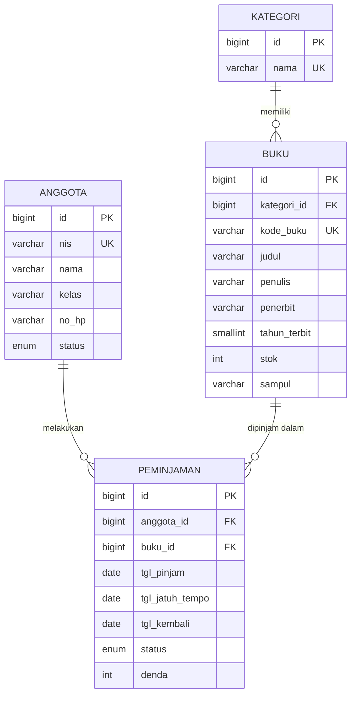

# Sistem Informasi Perpustakaan Sekolah

Tugas 1 – Pemrograman Web (Laravel). Ini web perpustakaan sekolah: siapa aja bisa ngintip katalog buku, sementara petugas punya panel sendiri buat ngatur kategori, buku, anggota, peminjaman, pengembalian, sampai denda telat. 📚

## Siapa yang bikin

Dikerjain **sendiri (individu)**, bukan kelompok.

| Keterangan | Isi |
|---|---|
| Tugas | Tugas 1 – Sistem Informasi Perpustakaan Sekolah |
| Nama | Dafa |
| Kelas | XI RPL 1 |
| Nama proyek / database | `perpustakaan-sekolah` / `db_perpustakaan` |
| Peran | Semuanya: rancangan, coding, testing, sampai dokumentasi |

## Versi yang dipakai

| Yang dipakai | Versi |
|---|---|
| PHP | 8.2 ke atas (dites di PHP 8.3) |
| Laravel | 12.x |
| Database | MySQL / MariaDB |
| Tampilan | Bootstrap 5.3 (CDN) + CSS sendiri (`public/css/app.css`) |
| Composer | 2.x |

Ekstensi PHP yang wajib nyala: `mbstring`, `openssl`, `pdo_mysql`, dan `fileinfo`. Kalau mau jalanin tes otomatis, `pdo_sqlite` juga harus nyala.

## Cara install

1. Ekstrak file ZIP-nya, terus buka terminal di folder proyek.
2. Pasang semua dependensi:

   ```bash
   composer install
   ```

3. Salin file konfigurasi dan bikin app key:

   ```bash
   cp .env.example .env        # Windows (CMD): copy .env.example .env
   php artisan key:generate
   ```

4. Bikin database kosong namanya `db_perpustakaan` (gampangnya lewat phpMyAdmin), terus cek bagian ini di `.env`, sesuaiin kalau perlu:

   ```env
   DB_CONNECTION=mysql
   DB_HOST=127.0.0.1
   DB_PORT=3306
   DB_DATABASE=db_perpustakaan
   DB_USERNAME=root
   DB_PASSWORD=
   ```

5. Bikin tabel sekalian isi data awal:

   ```bash
   php artisan migrate --seed
   ```

   Mau ngulang dari nol di database latihan? Pakai `php artisan migrate:fresh --seed`. Awas ya, perintah ini **ngehapus semua tabel**.

6. Sambungin folder penyimpanan biar cover buku bisa muncul, terus nyalain servernya:

   ```bash
   php artisan storage:link
   php artisan serve
   ```

7. Buka `http://127.0.0.1:8000`. Beres, gas! 🚀

## Akun buat login (akun uji)

Di Tugas 1 cuma ada satu jenis pengguna, yaitu petugas.

| Peran | Email | Kata sandi |
|---|---|---|
| Petugas | `petugas@sekolah.test` | `password` |

Kata sandi ini cuma buat latihan, ganti dulu kalau mau dipakai beneran.

## Data awal (seeder)

- 1 akun petugas
- 5 kategori
- 15 buku (2 di antaranya stoknya 0)
- 8 anggota (1 berstatus nonaktif)
- 6 riwayat peminjaman: lagi dipinjam, dikembalikan tepat waktu, dikembalikan telat (ada denda), dan lagi dipinjam tapi udah lewat jatuh tempo

## Fitur

| Kode | Fitur | Ringkasannya |
|---|---|---|
| F-01 | Login petugas | Login dan logout. Semua halaman `/admin/*` dijaga middleware `auth`, kata sandi di-hash, pesan error pakai bahasa Indonesia, dan isian email nggak ilang kalau login gagal. Abis login, petugas langsung diarahin ke `/admin/peminjaman`. |
| F-02 | Katalog publik | Beranda nampilin kartu buku (8 per halaman), bisa cari lewat `?q=` (judul, penulis, kode buku), filter `?kategori=`, ada label "Sedang dipinjam semua" kalau stok 0, dan halaman detail di `/buku/{buku}`. |
| F-03 | CRUD kategori | Nama kategori harus unik. Kategori yang masih punya buku nggak bisa dihapus. |
| F-04 | CRUD buku | Kode buku unik, tahun terbit 4 digit dan nggak boleh lebih dari tahun sekarang, stok bilangan bulat dan nggak negatif, cover JPG/PNG maksimal 2 MB disimpan di `storage/app/public`, file cover lama ikut kehapus kalau diganti, dan buku yang pernah dipinjam nggak bisa dihapus. |
| F-05 | CRUD anggota | NIS unik, nama dan kelas wajib diisi, nomor HP formatnya `08` + 10 angka, status aktif/nonaktif. Anggota yang punya riwayat peminjaman nggak bisa dihapus. |
| F-06 | Peminjaman | Petugas milih anggota dan buku. Anggotanya harus aktif, stok harus ada, maksimal 3 pinjaman aktif, dan judul yang sama nggak boleh dipinjam dua kali sebelum dibalikin. Tanggal pinjam diisi hari ini, jatuh tempo 7 hari kemudian, dan stok berkurang 1. |
| F-07 | Pengembalian dan denda | Stok nambah 1 dan denda dihitung Rp1.000 per hari telat. Pengembalian dobel ditolak. |
| F-08 | Riwayat peminjaman | Daftar transaksi plus filter status (dipinjam, dikembalikan, terlambat), pencarian nama anggota, dan badge status berwarna. |

### Aturan mainnya

- Catat peminjaman dan pengembalian jalan di dalam `DB::transaction()` dengan `lockForUpdate()` di baris buku, anggota, dan peminjaman. Jadi stok nggak bisa minus dan pengembalian nggak bisa kehitung dua kali.
- Status "terlambat" **nggak disimpan** di database. Statusnya dihitung dari `tgl_jatuh_tempo` dibandingin sama tanggal hari ini.
- Denda disimpan pas buku dikembalikan: `jumlah hari telat × Rp1.000`.
- Semua validasi dikerjain di server, dengan pesan error bahasa Indonesia.

## Struktur database



Ketiga foreign key pakai `ON DELETE RESTRICT`, jadi data yang masih kepake nggak bakal kehapus gara-gara salah pencet. Tabel `users` cuma buat akun petugas.

## Daftar route

| Metode | URI | Nama route | Controller |
|---|---|---|---|
| GET | `/` | `katalog` | `KatalogController@index` |
| GET | `/buku/{buku}` | `buku.show` | `KatalogController@show` |
| GET | `/login` | `login` | `AuthController@showLogin` |
| POST | `/login` | `login.store` | `AuthController@login` |
| POST | `/logout` | `logout` | `AuthController@logout` |
| GET | `/admin/peminjaman` | `admin.peminjaman.index` | `PeminjamanController@index` |
| GET | `/admin/peminjaman/create` | `admin.peminjaman.create` | `PeminjamanController@create` |
| POST | `/admin/peminjaman` | `admin.peminjaman.store` | `PeminjamanController@store` |
| PATCH | `/admin/peminjaman/{peminjaman}/kembali` | `admin.peminjaman.kembalikan` | `PeminjamanController@kembalikan` |
| Resource | `/admin/kategori` (tanpa `show`) | `admin.kategori.*` | `KategoriController` |
| Resource | `/admin/buku` | `admin.buku.*` | `BukuController` |
| Resource | `/admin/anggota` (tanpa `show`) | `admin.anggota.*` | `AnggotaController` |

Mau lihat daftar lengkapnya? Jalanin `php artisan route:list`.

## Pengujian

Jalanin semua tes otomatis (pakai SQLite di memori, jadi database MySQL-mu aman dan nggak kesentuh):

```bash
php artisan test
```

| No | Skenario jobsheet | Hasil yang diharapkan | Tes yang ngecek |
|---|---|---|---|
| 1 | Buka `/admin/peminjaman` tanpa login | Diarahin ke halaman login | `test_admin_pages_require_authentication_and_login_redirects_to_peminjaman` |
| 2 | Nambah buku dengan `kode_buku` yang udah ada | Ditolak, pesan validasi muncul, input lain tetap terisi | `test_duplicate_book_code_is_rejected_without_losing_other_form_input` |
| 3 | Proses peminjaman buku yang stoknya 0 | Ditolak dengan pesan jelas, nggak ada data peminjaman baru | `test_peminjaman_rejects_inactive_members_empty_stock_and_a_fourth_active_loan` |
| 4 | Anggota yang udah minjam 3 buku minjam buku ke-4 | Ditolak, stok buku nggak berubah | tes yang sama kayak nomor 3 |
| 5 | Balikin buku 3 hari setelah jatuh tempo | Status dikembalikan, denda Rp3.000, stok nambah 1 | `test_return_calculates_late_fee_and_cannot_increment_stock_twice` |
| 6 | Hapus kategori yang masih punya buku | Ditolak dengan pesan, data tetap ada | `test_related_records_cannot_be_deleted_and_invalid_phone_is_rejected` |
| 7 | Cari kata kunci sambil milih kategori, terus pindah ke halaman 2 | Hasil sesuai pencarian dan filter, filter tetap aktif di halaman 2 | `test_catalog_search_filters_by_category_and_keeps_filters_in_pagination` |

Ada juga tes tambahan buat ngecek seeder, peminjaman yang berhasil, upload cover, pembatasan percobaan login, dan kesesuaian skema serta route sama jobsheet (`tests/Feature/SesuaiJobsheetTest.php`).

## Struktur folder penting

```text
app/Http/Controllers/   AuthController, KatalogController, KategoriController,
                        BukuController, AnggotaController, PeminjamanController
app/Models/             User, Kategori, Buku, Anggota, Peminjaman
database/migrations/    skema tabel
database/seeders/       DatabaseSeeder (data awal), PetugasSeeder (akun petugas lewat variabel lingkungan)
resources/views/        layouts/app, partials/navbar dan flash, katalog, auth, admin
routes/web.php          semua route
tests/Feature/          tes otomatis
```

## Catatan tambahan

- **Cover buku** disimpan di `storage/app/public/sampul-buku`. Jalanin `php artisan storage:link` sekali di tiap lingkungan baru biar gambarnya muncul. Kalau hosting-nya suka ngehapus file upload tiap deploy, pasang penyimpanan permanen (volume) di folder `storage/app/public`.
- **Bikin akun petugas di server** tanpa data contoh: isi variabel `PETUGAS_EMAIL`, `PETUGAS_PASSWORD`, dan (opsional) `PETUGAS_NAMA`, terus jalanin `php artisan db:seed --class=PetugasSeeder --force`.
- File `.env` dan folder `vendor` sengaja nggak disertain pas dikumpulin. Pakai `.env.example` dan `composer install` aja.
